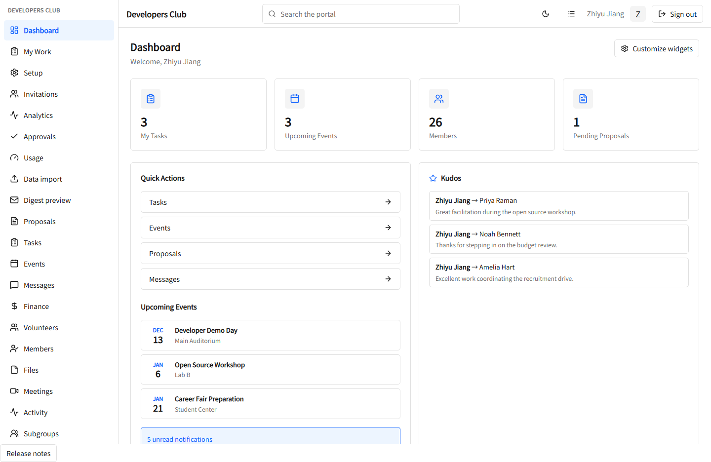
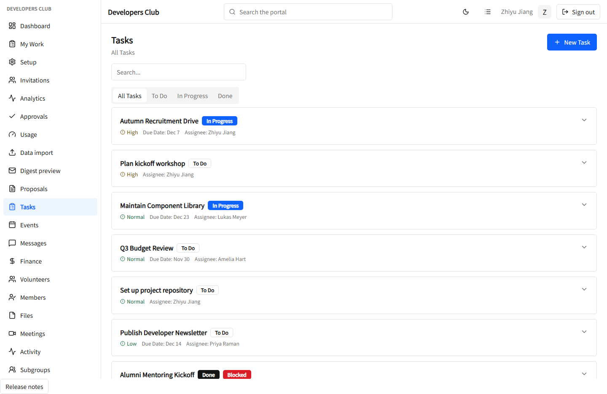
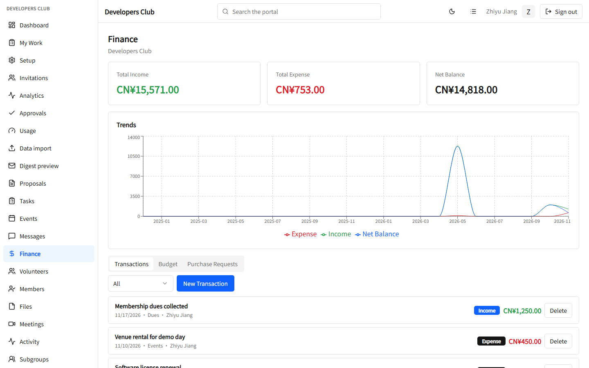
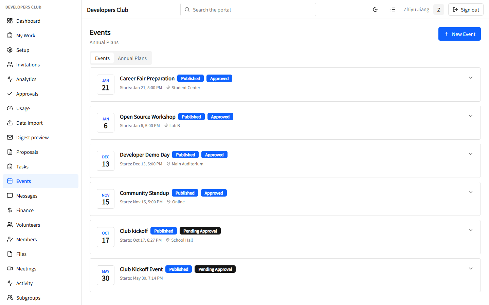
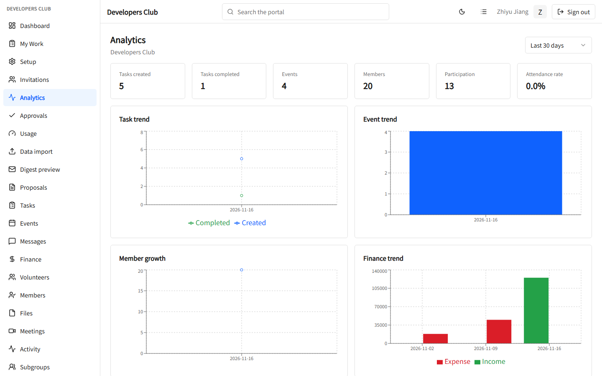
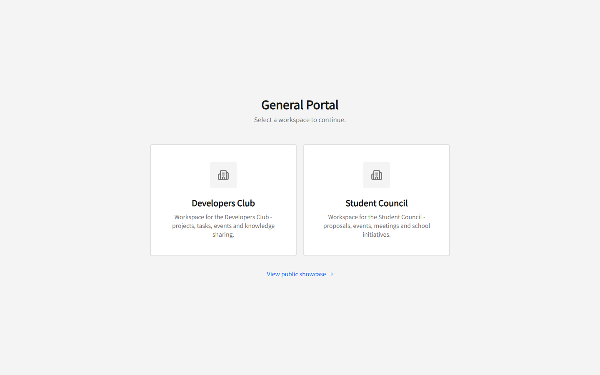
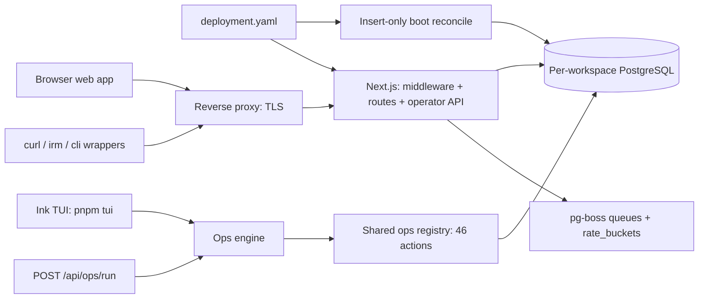

# General Portal

[](https://github.com/YGMssMGY/General-Portal/actions/workflows/ci.yml) [](LICENSE) [](https://nodejs.org/) [](https://pnpm.io/) [](https://nextjs.org/) [](https://www.typescriptlang.org/) [](https://www.postgresql.org/)

> General Portal — the self-hosted workspace OS. One deployment, isolated databases per workspace, 40+ modules, nine sign-in providers, your branding. Configured in YAML, operated from a TUI/CLI.

One Node.js deployment serves many independent portals. `deployment.yaml` declares each workspace's modules, navigation, branding, terminology, feature flags, limits, and sign-in providers. Every workspace gets its own PostgreSQL database, and a session for one workspace cannot read another. Operators configure the system in YAML and run it from an Ink terminal console or an HTTPS operator API reachable with `curl`, PowerShell `irm`, or thin wrappers — no SSH required.

License: GPL-3.0-or-later (see `LICENSE`).

## Screenshots

Real workspace screens from a migrated deployment with seeded demo data. The full 54-image gallery is in [`docs/SCREENSHOTS.md`](docs/SCREENSHOTS.md).

| Dashboard | Tasks | Finance |
| --- | --- | --- |
|  |  |  |

| Events | Analytics | Public site |
| --- | --- | --- |
|  |  |  |

## Architecture



The three frontends — browser app, Ink TUI, and operator API clients — share one service layer. `deployment.yaml` is the authority; boot reconcile (`instrumentation.ts`) inserts missing workspaces and system roles only, never updates or deletes, and tooling never auto-edits the YAML. Tenant identity comes from the opaque session, not the `portal` cookie hint, so a valid session for workspace A gets no data from workspace B. Money is stored as integer cents; deletes are soft with trash restore and a typed Danger Zone. Details in `docs/architecture.md`.

## Product site

The public web site is served from the same deployment as the app:

| Route | Purpose |
| --- | --- |
| `/features` | Product capabilities by area |
| `/compare` | Comparison with generic collaboration tools |
| `/use-cases/clubs`, `/use-cases/firms`, `/use-cases/agencies` | Audience-specific pages |
| `/changelog`, `/roadmap` | Release history and planned work |
| `/security`, `/about`, `/docs` | Security posture, project background, documentation entry point |
| `/demo` | Read-only preview of workspace screens; no tenant data or mutations |

SEO support lives alongside those routes: `src/app/sitemap.ts`, `robots.ts`, `manifest.ts`, generated Open Graph and Twitter images, and JSON-LD via `src/components/JsonLd.tsx`.

## Feature map

Organize:

- Tasks with dependencies, recurrence, subtasks, comments, attachments, and time tracking (`manage_time`)
- Calendar with scoped iCal feed (`GET /api/calendar/ical?token=`, `calendar:read` scope)
- Meetings with agenda, minutes, action items, RSVP, attendance codes, and check-in
- Polls with voting, goals with progress updates, annual event plans

Decide:

- Proposals with templates, approve/reject flow (`approve_proposal`), and attachments
- Workflows (`manage_workflows`), approvals inbox, decisions log (`manage_decisions`)

Money (all amounts stored as integer cents):

- Finance ledger (`amountCents`) with summary and trends (`manage_finance` for writes)
- Budgets with approve, spend, and reconcile flows (`manage_budget`)
- Purchase requests with review flow (`manage_purchase_requests`), dues collection (`manage_dues`)

People:

- Members with custom roles and per-role permission sets, member history, subgroups (per-site terminology, e.g. Guilds vs Committees), attendance recording, volunteer slots with signups and hours, participation leaderboard, kudos with leaderboard

Knowledge:

- Messages (threads, replies, read state) with mentions and reactions, files with versions and sha256 integrity, links with periodic health checks, public showcase, announcements (`manage_announcements`), trash with restore across 11 entity types

Platform:

- `deployment.yaml` drives modules, nav, branding (validated `#rrggbb` primary, radius clamped to 0-32 px and injected as inline CSS variables), terminology (`useTerm()`), features, and limits
- `pnpm tui`: Ink operator console with sites, migrate, backup, jobs, health, logs, danger, and a filterable Actions palette over the shared 46-action registry
- Operator API: `GET /api/ops` capability directory, `POST /api/ops/run`, `GET /api/ops/openapi.json`, `/api/ops/manifest.json`, `/api/ops/health`; scoped Bearer tokens; two-phase typed confirmations; zero-install via `curl` or `irm`
- pg-boss queues: `nudge`, `digest`, `report-generate`, `webhook-deliver`, `retention`, `link-health`, `scheduled-backup`
- Webhooks with HMAC `X-Portal-Signature` plus scoped API tokens (`manage_api_tokens`)
- OpenAPI description at `GET /api/public/openapi.json`
- Append-only audit log with sha256 hash chain plus `verifyAuditChain`; operator runs append to `.tui-audit.log`
- Streamed uploads with magic-byte sniffing, DNS-pinned SSRF guards with redirect revalidation, Postgres-backed rate limits, origin CSRF checks, and nonce CSP
- `pnpm config:check|init|diff|doctor` for YAML, env, seed-pack, connectivity, and upload-directory checks
- 5 locales (en-US, zh-CN, de-DE, fr-FR, es-ES) via next-intl
- Passkeys (WebAuthn), password auth (scrypt), email OTP / magic link, SSO (Microsoft Entra ID, Basis Auth, Google, GitHub, generic OIDC, SAML)

## Quick start (60 seconds)

Prereqs: Node >= 22.12, pnpm 10, PostgreSQL 14+, `pg_dump`/`pg_restore` on PATH for backups.

```bash
pnpm install
pnpm config:init    # writes deployment.example.local.yaml; never touches deployment.yaml
cp .env.example .env   # fill in per-portal DATABASE_URL_<SLUG> values
pnpm config:check      # validate YAML, env names, seed packs
MIGRATE_URL=<url> pnpm exec tsx scripts/migrate.ts
pnpm exec tsx scripts/seed.ts <slug>
pnpm config:doctor     # connectivity, applied migrations, uploads directory
pnpm dev
pnpm tui               # interactive TTY only
```

`pnpm config:init` creates `deployment.example.local.yaml` and refuses to overwrite it on later runs; your live `deployment.yaml` is never modified. `scripts/migrate.ts` also accepts the connection string as argv (`tsx scripts/migrate.ts <url>`) and records applied files in `public.schema_migrations`. `scripts/seed.ts` defaults to `deployments/seed-packs/<slug>.yaml` and is idempotent. The dev server runs `next dev --turbopack`.

## Scripts

Every script in `package.json`:

| Script | Command | Purpose |
| --- | --- | --- |
| `dev` | `next dev --turbopack` | Local dev server |
| `build` | `next build` | Production build |
| `start` | `next start` | Serve production build |
| `lint` | `eslint .` | ESLint 10 with Next.js + `process.env` ban |
| `typecheck` | `tsc --noEmit` | Strict type check |
| `test:unit` | `vitest run` | Vitest unit suite |
| `i18n:check` | `node scripts/checks.cjs i18n` | Five-locale key parity (missing and extra keys) |
| `seo:check` | `node scripts/checks.cjs seo` | SEO files, landing metadata, no self-fetch |
| `security:check` | `node scripts/checks.cjs security` | Static scan for banned patterns |
| `perf:check` | `node scripts/checks.cjs perf` | `EXPLAIN ANALYZE` on indexed queries via `MIGRATE_URL`; skips when unset |
| `db:generate` | `drizzle-kit generate` | Generate SQL migration from `src/db/schema.ts` |
| `db:migrate` | `tsx scripts/migrate.ts` | Apply pending migrations (`MIGRATE_URL` or argv) |
| `db:push` | `drizzle-kit push` | Push schema directly (dev only) |
| `db:studio` | `drizzle-kit studio` | Open Drizzle Studio |
| `db:seed` | `tsx scripts/seed.ts` | Seed a portal (`<slug> [packFile] [--set-password e=p]`) |
| `db:seed:demo` | `tsx scripts/seed-demo.ts` | Idempotent realistic demo data for both portals (~127 rows each) |
| `screenshots` | `tsx scripts/screenshots.ts` | 54 sequential low-impact headless screenshots into `docs/screenshots/` |
| `config:check` | `tsx scripts/config.ts check` | Validate YAML, DB env vars, seed packs; exits 1 on failure |
| `config:init` | `tsx scripts/config.ts init` | Write `deployment.example.local.yaml`; never overwrites or edits `deployment.yaml` |
| `config:diff` | `tsx scripts/config.ts diff` | Compare YAML name, description, and logo with live workspace rows |
| `config:doctor` | `tsx scripts/config.ts doctor` | Check config, DB connectivity, migration counts, uploads directory |
| `tui` | `tsx src/tui/index.tsx` | Operator console (TTY only) |
| `smoke` | `tsx scripts/smoke.ts` | Live-server smoke suite (`SMOKE_EMAIL`, `SMOKE_PASSWORD`) |
| `test:e2e` | `playwright test` | Playwright suite, workers: 1 |
| `verify` | `bash scripts/verify.sh` | oxfmt check + lint + typecheck + build + unit tests + i18n + SEO + security checks |

`config:check`, `config:diff`, and `config:doctor` are also available as operator actions (`config.check`, `config.diff`, `config.doctor`). See `docs/deployment.md`.

## Project structure

```text
src/
  app/                  # Routes: page.tsx, [portal]/, login/, showcase/, api/
  app/{features,compare,use-cases,changelog,roadmap,security,about,docs,demo}/  # Public product site
  app/sitemap.ts,robots.ts,manifest.ts,opengraph-image.tsx,twitter-image.tsx  # SEO assets
  app/api/ops/          # Operator API: directory, run, openapi.json, manifest.json, health
  db/                   # client.ts (per-portal pools), schema.ts, migrations/
  lib/                  # tenant, permissions, api, audit, auth/, jobs/, deployment/, ops guards
  lib/auth/             # oidc, session, passwords, providers, saml, email, rate-limit
  lib/jobs/             # boss, nudge, digest, reports, webhooks, retention, link-health
  lib/deployment/       # index, schema, reconcile (deployment.yaml authority)
  ops/                  # Shared operator registry: actions/, engine.ts, registry.ts, lib/
  config/index.ts       # Typed env accessor (only sanctioned process.env reader)
  middleware.ts         # Nonce CSP, origin CSRF, rate limits, locale, auth gate
  i18n/routing.ts       # 5 locales, as-needed prefix, en-US default
  tui/                  # Ink console: App + screens/ (including Actions) + lib/
  lib/seo.ts            # Site URL helper for metadata and JSON-LD
  components/JsonLd.tsx # Structured-data helper for public pages
cli/                    # gp.sh, gp.ps1: operator wrappers over the HTTP API
.github/                # CODEOWNERS, issue/PR templates, dependabot, labeler, CI/e2e
scripts/                # migrate.ts, seed.ts, config.ts, smoke.ts, verify.sh
deployments/seed-packs/ # developers_club.yaml, student_council.yaml
messages/               # en-US, zh-CN, de-DE, fr-FR, es-ES JSON
tests/e2e/              # auth.setup.ts, public.spec.ts, portal.spec.ts
docs/                   # architecture, deployment, auth, security, i18n, tui, api, runbook
deployment.yaml         # Site authority (portals, modules, nav, roles, limits, providers)
drizzle.config.ts       # schema ./src/db/schema.ts, out ./src/db/migrations
```

## Auth providers

| Provider | Required env | Visibility rule |
| --- | --- | --- |
| `password` | none (always on) | Always shown |
| `passkey` | none (derives rpId/origin from base URL) | Always shown |
| `microsoft-entra-id` | `MICROSOFT_CLIENT_ID`, `MICROSOFT_CLIENT_SECRET` (`MICROSOFT_TENANT_ID`, default `common`) | Only when fully configured |
| `basis-auth` | `BASIS_AUTH_ISSUER`, `BASIS_AUTH_CLIENT_ID`, `BASIS_AUTH_CLIENT_SECRET`, `BASIS_AUTH_REDIRECT_URI`, `BASIS_AUTH_RESOURCE` | Only when all five are set |
| `google` | `GOOGLE_CLIENT_ID`, `GOOGLE_CLIENT_SECRET` | Only when fully configured |
| `github` | `GITHUB_CLIENT_ID`, `GITHUB_CLIENT_SECRET` | Only when fully configured |
| `oidc` | `OIDC_ISSUER`, `OIDC_CLIENT_ID`, `OIDC_CLIENT_SECRET` (`OIDC_REDIRECT_URI` optional) | Only when fully configured |
| `saml` | `SAML_ENTRY_POINT`, `SAML_ISSUER`, `SAML_CERT` | Only when fully configured |
| `email-otp` | `SMTP_HOST`, `SMTP_FROM` (plus `SMTP_PORT/USER/PASS` as needed) | Only when mail is configured |

Magic link is a purpose of `email-otp` (`purpose: magic-link`), not a tenth provider. Env-gating invisibility rule: a provider with missing env has zero UI trace. It is filtered from `GET /api/auth/providers`, and direct login attempts redirect with `AccessDenied` or return generic `503 Sign-in is unavailable right now`. Error messages never name the missing variable. Details in `docs/auth.md`.

## Operator API and CLI

The same 46 registered actions drive the local TUI Actions palette and the remote operator API. Discovery endpoints (`GET /api/ops`, `/api/ops/openapi.json`, `/api/ops/manifest.json`, `/api/ops/health`) carry no secrets. Execution uses `POST /api/ops/run` with a Bearer operator token; HTTPS is required in production. No SSH is used anywhere.

Scopes are `ops:read`, `ops:deploy`, `ops:backup`, and `ops:danger`. The bootstrap token `OPS_API_TOKEN` carries all four scopes. Mint narrower, short-lived tokens with the `ops.token` action (requires `ops:danger`); `OPS_SECRET` signs issued tokens and confirmation tokens and falls back to `AUTH_SECRET` when unset. Optional `OPS_ALLOWED_IPS` restricts source IPs. Destructive actions return `409` on the first call with a `confirmationToken`, a preview, and a five-minute expiry; repeat with that token and `typedValue` equal to the target slug or email. Supply `idempotencyKey` (or the `Idempotency-Key` header) for safe retries within ten minutes. Every run, including denials, appends to `.tui-audit.log`.

Discover what you can run:

```bash
export GP_URL=https://portal.example
export GP_TOKEN='<operator-token>'
curl -sS "$GP_URL/api/ops" -H "Authorization: Bearer $GP_TOKEN"
curl -sS -X POST "$GP_URL/api/ops/run" \
  -H "Authorization: Bearer $GP_TOKEN" \
  -H 'Content-Type: application/json' \
  -d '{"action":"site.health","params":{}}'
```

PowerShell, no install required:

```powershell
$env:GP_URL = 'https://portal.example'
$env:GP_TOKEN = '<operator-token>'
irm -Uri "$env:GP_URL/api/ops" -Headers @{ Authorization = "Bearer $env:GP_TOKEN" }
irm -Method Post -Uri "$env:GP_URL/api/ops/run" `
    -Headers @{ Authorization = "Bearer $env:GP_TOKEN" } `
    -ContentType 'application/json' `
    -Body '{"action":"site.health","params":{}}'
```

For repeated use, the checked-in wrappers `cli/gp.sh` and `cli/gp.ps1` read the same `GP_URL` and `GP_TOKEN` and support `list`, `explain`, `run`, or any action id with a JSON params object. The action groups are site, migrate, backup (+ `dr.drill`), job, ops, config, user, data, system, webhook, and danger. Full list, request shape, status codes, and examples are in `docs/api.md`; remote operation is in `docs/tui.md`.

## i18n

5 locales: `en-US` (default), `zh-CN`, `de-DE`, `fr-FR`, `es-ES`. next-intl with `localePrefix: as-needed`; locale resolves from the `NEXT_LOCALE` cookie, then `Accept-Language`, then the default. Every UI string uses `t()` with all-5-file parity; terminology from YAML is exposed to client components through `useTerm()`. Details in `docs/i18n.md`.

## Why not build this yourself?

| Concern | Build it in-house | General Portal |
| --- | --- | --- |
| Tenant isolation | Design per-tenant routing and prove no cross-tenant read | Session-bound tenant resolution, one database per workspace, cross-portal smoke check |
| Sign-in | Integrate and maintain nine flows, PKCE, SAML, passkeys, OTP mail | Nine providers with env-gated invisibility and a single membership gate |
| Domain modules | Build and test tasks, meetings, finance, proposals, and the rest | 40+ modules with permission gates, integer-cent money, soft deletes, trash restore |
| Operations | Write scripts for provision, migrate, backup, restore, and DR drills | One shared registry exposed through the TUI and a scoped HTTPS operator API |
| Branding and language | Hard-code theme, nav, labels, and translations | YAML-driven nav, modules, branding, terminology, features, limits; five locales |
| Audit and safety | Add hash-chained audit and typed confirmations yourself | Hash-chained audit, operator audit log, two-phase typed confirmations, insert-only reconcile |
| Upgrade path | Rebase your customizations on every framework change | `pnpm verify`, idempotent seed, per-database migrations, documented runbook |

## License

GPL-3.0-or-later. See `LICENSE` at the repo root.

## Docs

- `docs/architecture.md` — layers, frontends, ops registry, tenant resolution, request flow, queues
- `docs/deployment.md` — env reference, operator API settings, `deployment.yaml` keys, config commands, provisioning, backups, recovery
- `docs/auth.md` — providers, Basis Auth rules, passwords, passkeys, sessions, tokens
- `docs/security.md` — threat model, headers, authZ matrix, isolation, uploads, SSRF, rate limits, agent API
- `docs/i18n.md` — locales, key workflow, review status
- `docs/tui.md` — operator console screens, Actions palette, safety rails, remote operation
- `docs/api.md` — envelope, pagination, endpoint catalogue, operator API, webhooks
- `docs/sdk.md` — typed fetch client, authentication, pagination, and errors
- `docs/runbook.md` — operations, config doctor, operator tokens, DR drills, health, recovery
- `docs/FEATURES.md` — auditable feature completeness manifest
- `docs/SCREENSHOTS.md` — 54-image gallery of the public site and workspace modules

## Contributing

Start with the issue templates in `.github/ISSUE_TEMPLATE/` and the checklist in `.github/PULL_REQUEST_TEMPLATE.md`. Run `pnpm verify` before opening a pull request; add every new UI string to all five locale files and keep the repo free of emojis.

| Level | How to enter | What you can do |
| --- | --- | --- |
| Reader | Clone, `pnpm install`, `pnpm dev` | Run the app, read `docs/`, try `pnpm config:check` |
| Reporter | File an issue from the templates | Report a bug with portal slug, route, and timestamp; never attach tokens |
| Fixer | Pick an issue, open a PR with `pnpm verify` green | Patch code, add tests, keep docs and locale files in lockstep |
| Reviewer | Repeat contributions in an area | Review PRs for tenant scope, permissions, audit, and i18n parity |
| Maintainer | Trusted commit access (see `.github/CODEOWNERS`) | Own modules, approve releases, rotate operator credentials |

## Security

Report vulnerabilities privately through GitHub Security Advisories for this repository (see `SECURITY.md`); do not open a public issue. Include the portal slug, route, and timestamp; never include session or operator tokens. The threat model, controls, and operator/agent API guidance are in `docs/security.md`.
