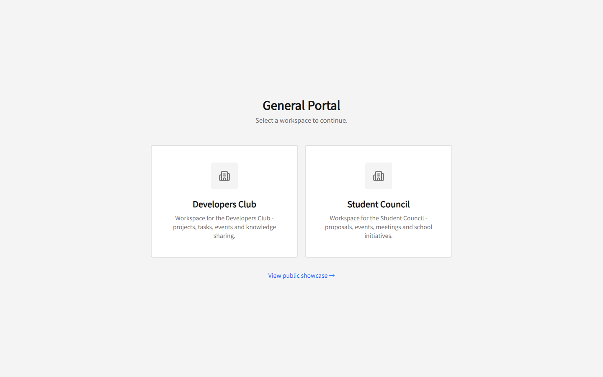
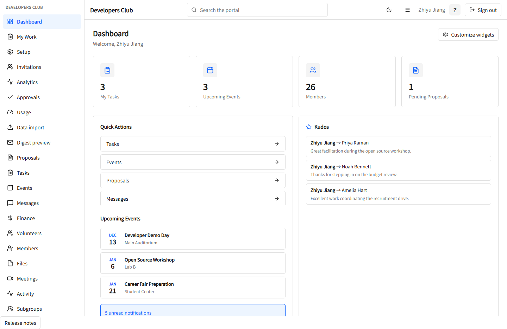
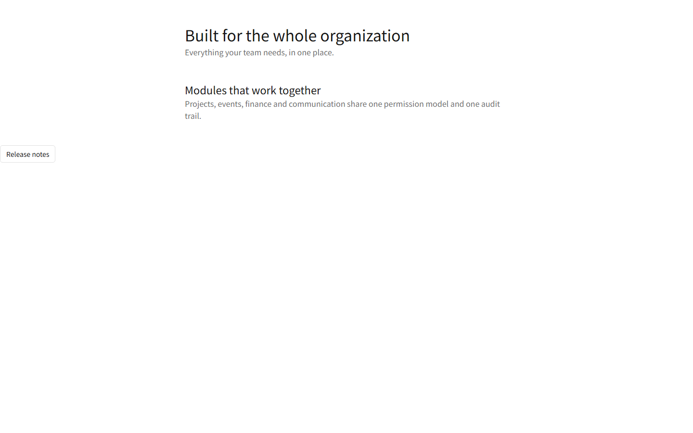
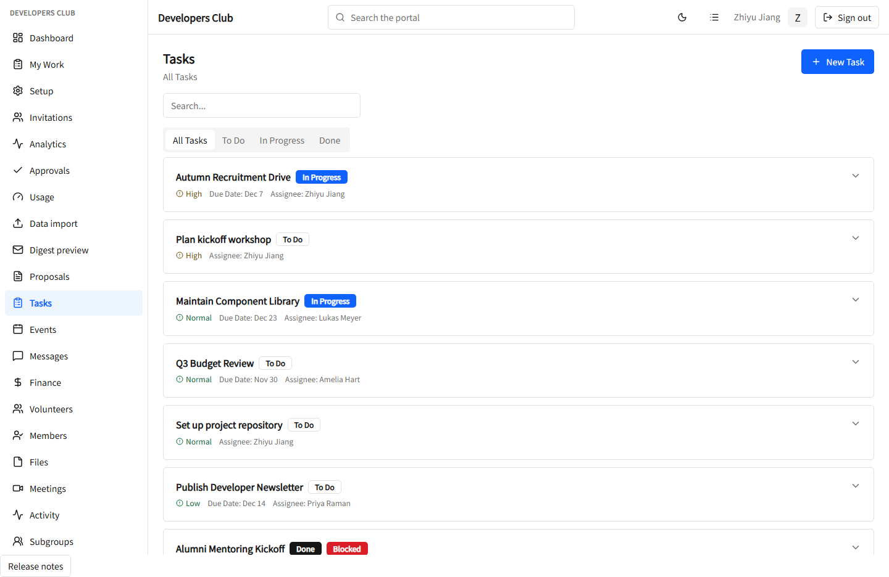
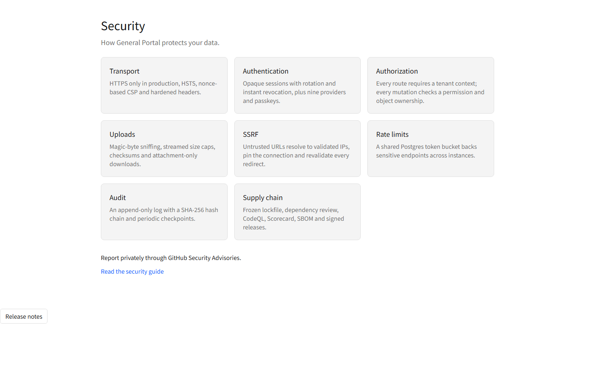
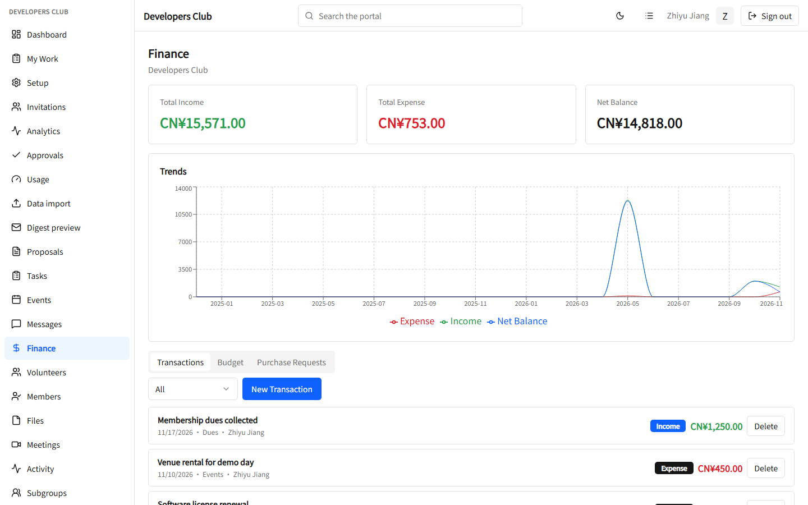
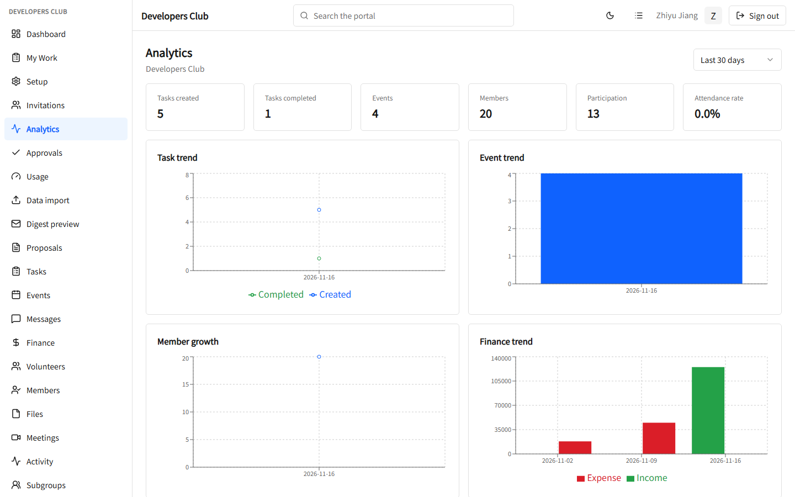

# Screenshot gallery

54 screenshots captured from a live, migrated deployment with realistic demo data in both the `developers` and `stuco` portals. They are generated by `pnpm screenshots`, not hand-edited, so they stay reproducible.

## Highlights

| Public site                              | Workspace                                  |
| ---------------------------------------- | ------------------------------------------ |
|    |  |
|  |          |
|  |      |



## All screenshots

### Public site (14)

| #   | Screen              | File                        |
| --- | ------------------- | --------------------------- |
| 01  | Workspace selector  | `01-landing.png`            |
| 02  | Password sign-in    | `02-login.png`              |
| 03  | Public showcase     | `03-showcase.png`           |
| 04  | Features            | `04-features.png`           |
| 05  | Comparison          | `05-compare.png`            |
| 06  | Interactive demo    | `06-demo.png`               |
| 07  | Documentation entry | `07-docs.png`               |
| 08  | Security posture    | `08-security.png`           |
| 09  | About               | `09-about.png`              |
| 10  | Use case: clubs     | `10-use-cases-clubs.png`    |
| 11  | Use case: firms     | `11-use-cases-firms.png`    |
| 12  | Use case: agencies  | `12-use-cases-agencies.png` |
| 13  | Changelog           | `13-changelog.png`          |
| 14  | Roadmap             | `14-roadmap.png`            |

### Workspace core (18)

| #   | Screen                                 | File                       |
| --- | -------------------------------------- | -------------------------- |
| 15  | Dashboard with widgets                 | `15-dashboard.png`         |
| 16  | Tasks with dependencies and recurrence | `16-tasks.png`             |
| 17  | Events                                 | `17-events.png`            |
| 18  | Proposals                              | `18-proposals.png`         |
| 19  | Calendar                               | `19-calendar.png`          |
| 20  | Messages                               | `20-messages.png`          |
| 21  | Finance ledger and trends              | `21-finance.png`           |
| 22  | Budget allocations                     | `22-budget.png`            |
| 23  | Purchase requests                      | `23-purchase-requests.png` |
| 24  | Volunteer slots                        | `24-volunteers.png`        |
| 25  | Members and roles                      | `25-members.png`           |
| 26  | Files with versions                    | `26-files.png`             |
| 27  | Meetings                               | `27-meetings.png`          |
| 28  | Activity feed                          | `28-activity.png`          |
| 29  | Subgroups                              | `29-subgroups.png`         |
| 30  | Settings                               | `30-settings.png`          |
| 31  | Notifications                          | `31-notifications.png`     |
| 32  | Search                                 | `32-search.png`            |

### Advanced modules (22)

| #   | Screen                    | File                    |
| --- | ------------------------- | ----------------------- |
| 33  | My Work                   | `33-my-work.png`        |
| 34  | Analytics                 | `34-analytics.png`      |
| 35  | Approvals inbox           | `35-approvals.png`      |
| 36  | Badges                    | `36-badges.png`         |
| 37  | Participation leaderboard | `37-participation.png`  |
| 38  | Polls                     | `38-polls.png`          |
| 39  | Goals and key results     | `39-goals.png`          |
| 40  | Kudos                     | `40-kudos.png`          |
| 41  | Dues                      | `41-dues.png`           |
| 42  | Assets and loans          | `42-assets.png`         |
| 43  | Decisions log             | `43-decisions.png`      |
| 44  | Workflows                 | `44-workflows.png`      |
| 45  | Attendance                | `45-attendance.png`     |
| 46  | Reports                   | `46-reports.png`        |
| 47  | Trash and restore         | `47-trash.png`          |
| 48  | Saved views               | `48-saved-views.png`    |
| 49  | Webhooks                  | `49-webhooks.png`       |
| 50  | API tokens                | `50-api-tokens.png`     |
| 51  | Custom fields             | `51-custom-fields.png`  |
| 52  | Operator health           | `52-admin-health.png`   |
| 53  | Audit trail               | `53-admin-audit.png`    |
| 54  | API documentation         | `54-admin-api-docs.png` |

## Regenerate

Start the app against migrated and seeded databases, then run:

```bash
pnpm db:seed:demo
pnpm screenshots http://localhost:3000
```

`SMOKE_EMAIL` and `SMOKE_PASSWORD` must point to a seeded administrator (the same values used by `pnpm smoke` and `pnpm test:e2e`). The capture uses one headless Chromium instance, one browser context, and one page, navigates sequentially, disables animation, and reports per-page `PASS`/`FAIL`. Any page error or 5xx response fails the run.
